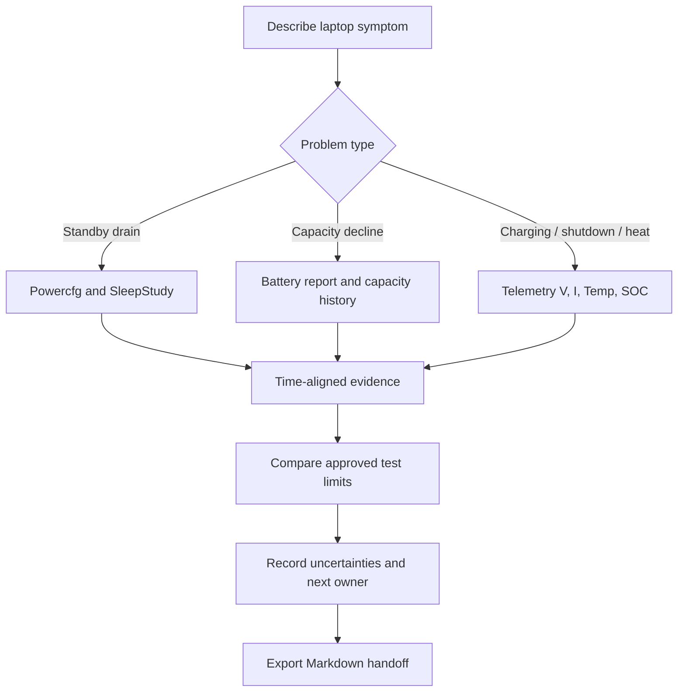

# PackFit Engineering v0.8 — Visual Laptop Battery Workbench

PackFit v0.8 connects everyday laptop symptoms with engineering evidence. It is **not** a battery certification or thermal safety tool. No imported file is uploaded to a cloud API.

## Five connected workflows

| Workspace | Native visual | Input / method | Limitation |
| --- | --- | --- | --- |
| **Battery Visuals** | Capacity-retention bars and full-charge capacity history | Windows `powercfg /batteryreport` or imported HTML | History is displayed only for a single installed battery; multi-battery history is not silently combined |
| **Telemetry Charts** | Four distinct trends: voltage (V), current (A), temperature (°C), SOC (%) | Local CSV/TSV with time-zone timestamps and explicit units | Chart is bounded/downsampled to keep performance predictable; original file remains the evidence |
| **Pack Diagram Studio** | Native S/P grouping drawn as cell blocks | Cell count, V, Ah, mass and pack envelope | Electrical connection concept only; not a BMS, connector, structure or validated packing study |
| **Sleep & Drain** | Before/after SOC bars, %/hour, optional Wh/h estimate | Manually entered SOC, duration, measured capacity | SOC delta is not a direct power-meter reading or an OEM standby compliance limit |
| **Workflow / Triage** | Step-by-step next-evidence flow | Symptoms, imported findings, Windows `powercfg` commands | Suggests next checks without declaring a root cause |

The **Advanced Tools** guide already links to the official Microsoft WPR/WPA, Process Monitor, Powercfg and SleepStudy references. It does not automatically download, install, elevate, or execute optional third-party software.

## From a symptom to an evidence-backed handoff

Every diagnosis has at least two questions: *what evidence exists?* and *which evidence is missing?* The system does not infer hardware faults from a capacity number or temperature flag alone.

## Basic / Engineering mode

- **Basic** exposes Overview, Battery, Visualizations, Sleep/Drain, guided investigation and built-in Windows diagnostics.
- **Engineering** exposes every section, including telemetry thresholds, validation matrices, pack estimation, reports and advanced tools.

Changing modes hides or shows navigation entries without deleting imported data. The mode is a UI convenience, **not an access-control or confidentiality feature**.

## No data? Load synthetic examples

On the homepage or Visualizations tab, click **載入合成示範資料**. The demo includes:

- A fictional battery with **56 Wh design / 49 Wh full** and three capacity-history periods.
- A fictional time-stamped V/I/temperature/SOC dataset with a temperature flag against **example** thresholds.
- A made-up validation matrix with PASS, FAIL and NOT RUN outcomes.
- A 3S1P nominal Pack diagram using the currently visible example geometry and cell parameters.

No proprietary OEM, supplier, customer or personal information is included. The demo is not a measured platform result and does not establish safety thresholds.

## Native chart implementation

Charts use WinUI `Canvas`, `Line`, `ProgressBar`, `Border` and `Viewbox`, without WebView or a graph dependency. Each signal has its own axis; missing numeric points are not connected, and a bounded sampling buffer avoids a heavy 200k-element graph.

### Formulas

**Capacity retention**: `full-charge Wh / design Wh × 100`. Values greater than 100% may occur with differences in reported versus design capacity; do not force a health verdict from the percentage.

**Standby loss**: `(start SOC − end SOC) / duration (h)` in percentage points per hour. Optional energy `(start − end) / 100 × full-charge Wh` and average `energy Wh / h`. This is a **simplified estimate** and assumes the user-supplied capacity and SOC delta are meaningful.

**Pack topology**: `V = S × cell nominal V`; `Ah = P × cell Ah`; `Wh = V × Ah`; `cells = S × P`. Packaging density assumes the user-supplied total mass and rectangular bounding dimensions, not CAD or thermal constraints.

**Telemetry history**: retains a bounded, chronological preview of the imported timestamp, V, A, °C, and SOC samples. Full findings and source files are not replaced by the chart.

## Windows launch compatibility

The full WinUI workspace and the C#-built compatibility workspace now both include native charts and synthetic demonstration data. Use `PackFit.Engineering.exe --safe-ui` if the normal XAML shell cannot load. Safe mode does not instantiate `MainWindow.xaml`.

GitHub Actions performs **separate native smoke tests** for full MainWindow, fallback workbench, and chart/demo initialization. CI still cannot prove UI interaction on every physical Windows laptop; report on-device issues with sanitized evidence.

## Official references

- [Microsoft powercfg options](https://learn.microsoft.com/en-us/windows-hardware/design/device-experiences/powercfg-command-line-options)
- [Microsoft WPR / WPA](https://learn.microsoft.com/en-us/windows-hardware/test/wpt/introduction-to-wpr)
- [Microsoft Modern Standby test prerequisites](https://learn.microsoft.com/en-us/windows-hardware/design/device-experiences/modern-standby-testing-prerequisites)
- [Microsoft Fluent app structure](https://learn.microsoft.com/en-us/windows/apps/develop/ui/windows-app-sdk-app-structure)
